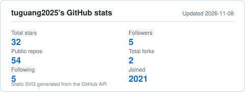
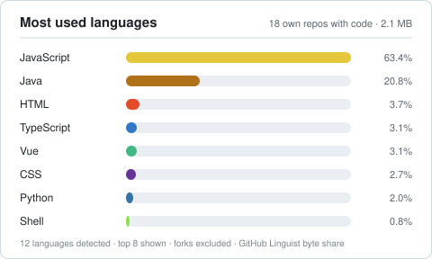
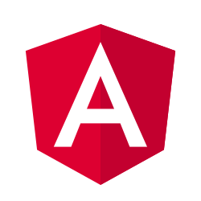

# 👋 Hi, I'm tuguang (tuguang2025)

**Front-end developer from China · open to remote opportunities**

My repositories cover frontend work, backend templates and Web3 tooling. Everything on this page is served from this repository — no third-party image services.

---

## 📊 GitHub Stats

<picture>
  <source media="(prefers-color-scheme: dark)" srcset="https://raw.githubusercontent.com/tuguang2025/tuguang2025/main/assets/stats-dark.svg">
  
</picture>

<picture>
  <source media="(prefers-color-scheme: dark)" srcset="https://raw.githubusercontent.com/tuguang2025/tuguang2025/main/assets/langs-dark.svg">
  
</picture>

**32** stars earned · **54** public repos · **5** followers · refreshed daily by [GitHub Actions](.github/workflows/update-stats.yml) with data from the GitHub API ([generator](scripts/gen_stats.py)).

---

## 🛠️ Languages & Tools

**Frontend**

  
  
  
  
  
  

**Backend & Runtime**

  
  

**Data & Infra**

  
  
  
  
  

---

## 📌 Featured Repositories

| Repository | Language | Stars | About |
| --- | --- | ---: | --- |
| [node-template](https://github.com/tuguang2025/node-template) | JavaScript | 3 | Node.js + Express + Sequelize + MySQL backend template |
| [sui-wallet](https://github.com/tuguang2025/sui-wallet) | Python | 3 | Sui wallet generator |
| [tuguang-search](https://github.com/tuguang2025/tuguang-search) | Java | 3 | — |
| [aptos-wallet](https://github.com/tuguang2025/aptos-wallet) | Python | 2 | Aptos wallet generator |
| [springboot-template](https://github.com/tuguang2025/springboot-template) | Java | 2 | Spring Boot + MySQL + MyBatis-Plus backend template |
| [ElasticView](https://github.com/tuguang2025/ElasticView) | — | 1 | Elasticsearch visualization client |

---

## 📫 Get in Touch

Open to remote opportunities — reach me on [GitHub](https://github.com/tuguang2025) or open an [issue in this repo](https://github.com/tuguang2025/tuguang2025/issues).

Profile README · static SVGs generated from the GitHub API · no external services required at view time
